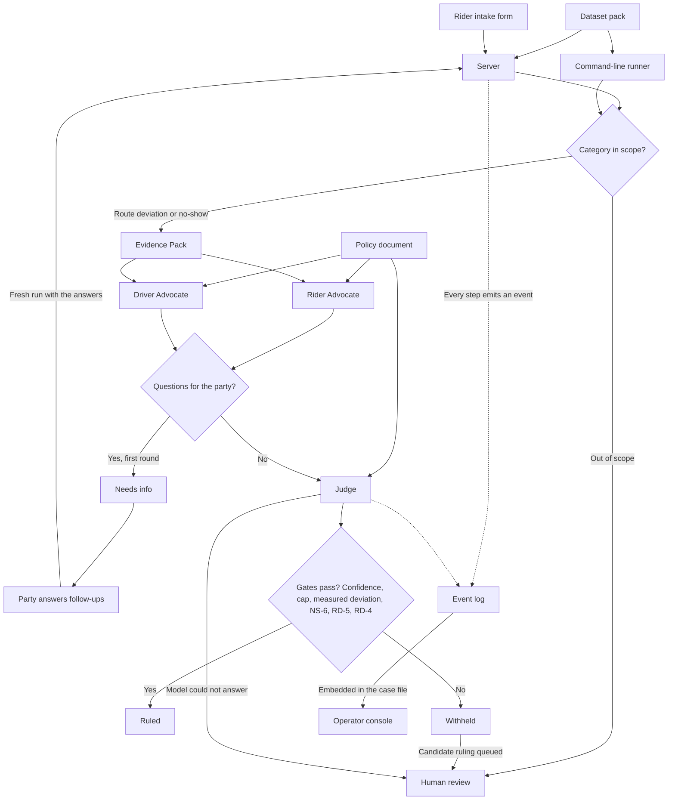

# Ryde — Multi-Agent Autonomous Dispute Resolution

Entry for the **Tencent Cloud "AI CAN DO IT" Hackathon Singapore 2026**, Digital Native track
(the Ryde challenge statement, section 5 of the organisers' document).

**Status: the system runs end to end on the real Tencent Cloud model (ADP), with the
deterministic mock as the default for a fresh checkout.** The scope is ruled: a two-category MVP
(route deviation + no-show charge) with three agents, a deterministic evidence layer, and an
observable case-file view. The challenge statement is in
[`docs/statement-extract.md`](docs/statement-extract.md); the builder's contract is in
[`CODEBUDDY.md`](CODEBUDDY.md).

## The challenge

Ride-hailing platforms process thousands of dispute tickets daily: fare disputes, route deviations,
property damage, safety incidents, no-show charges. They are subjective, emotionally charged, and
currently resolved by humans reviewing GPS telemetry, chat logs, payment records and company policy
by hand. The result is slow, expensive and inconsistent.

The task is an autonomous multi-agent system that gathers evidence, builds both sides' cases, applies
company policy and issues a fair ruling with a confidence score and a plain-language explanation.

## Architecture

Three core agents, all MVP-required:

| Agent | Role |
|---|---|
| **Rider Advocate** | Builds the rider's case from the Evidence Pack and the policy |
| **Driver Advocate** | Builds the driver's case from the Evidence Pack and the policy |
| **Judge** | Weighs both cases, applies policy, rules, and explains the reasoning with a confidence score |

Inter-agent communication must be **observable** — a judge needs to see how the agents exchange
information and build their cases. That surface is a required deliverable, not a nice-to-have.

The full walkthrough — components, lifecycle, gates, observability — is in
[`docs/architecture.md`](docs/architecture.md). The system on one page:



## Documents

- [`docs/statement-extract.md`](docs/statement-extract.md) — the challenge statement, verbatim
- [`docs/architecture.md`](docs/architecture.md) — architecture diagram and system description
- [`docs/policy.md`](docs/policy.md) — the policy rule set the Judge applies, with per-rule provenance
- [`docs/dataset.md`](docs/dataset.md) — the labelled corpus, its provenance and its limitations
- [`docs/evidence-plan.md`](docs/evidence-plan.md) — development-process evidence rules
- [`CODEBUDDY.md`](CODEBUDDY.md) — builder's entry point and project memory

## Development tooling

Built with Tencent Cloud **CodeBuddy**. The competition mandates proof of product usage, so
development happens in the tool and evidence is captured as it occurs.

## Run

No dependencies and no API key needed for a first look: it runs on a stock Python 3.9+ with the
standard library only, using a deterministic mock in place of the LLM.

```bash
python3 -m unittest discover -s tests -t .
python3 -m app.cli --pack ryde-synth-v1 --dispute RD-0101
python3 -m app.cli --pack organiser-style-v1 --dispute DISP-002
```

The evaluation harness replays every labelled case — `python3 -m app.eval --llm tencent --repeat 3` —
and scores the rulings against the labels, answering a round-one stop and running it again.

`--dispute` takes either a dispute id inside the selected pack or a path to a record file
(`python3 -m app.cli --dispute data/packs/ryde-synth-v1/disputes/RD-0101.json`). The pack
defaults to `dataset_pack` in `app/config.json`; `--pack` overrides it for one run.

That prints the agent-to-agent event strip and the ruling, and writes the run's artifacts to
`runs/<run_id>/`: `events.jsonl` (the observable traffic), `payloads/*.json` (the full payload
behind each event) and `case_file.json` (evidence, both claims, resolution).

The corpus lives in two swappable packs under `data/packs/`: `ryde-synth-v1` (our 17 labelled
cases, our record shape) and `organiser-style-v1` (the same 17 cases as twins in the organisers'
shape, plus the organisers' own `DISP-002` verbatim). `RD-0103` is a deviation too small to
matter, `NS-0203` is a driver who marked arrival 885 m from the pickup point, `RD-0109` is a
remedy above the autonomous cap that the system refuses to issue on its own, and `OS-0301` is an
out-of-scope filing routed to human review without an LLM call. `docs/dataset.md` maps each case
to what it tests; `<pack>/ground-truth.json` holds the expected outcomes, deliberately kept out
of the records the agents see.

Six gates stand between a ruling and the parties, and **all six are enforced in Python, not
asked of the model in a prompt**: the confidence threshold, ESC-4's SGD 50 autonomous cap, ESC-2,
which withholds a route-case ruling when the deviation cannot be measured or the fare charged
cannot be established, NS-6, which withholds a
contested no-show unless the ruling is a refund of exactly the fee for a low fee and a clean rider
record, RD-5, which withholds a route ruling that refunds less than the overcharge the records
prove, and RD-4, which withholds a route refund larger than the records prove the rider overpaid
(a fixed fare paid as quoted proves nothing) and any compensation on a route case. Each gate
withholds the ruling for a human; none of them rewrites what the Judge proposed.
Try them:

```bash
python3 -m app.cli --pack ryde-synth-v1 --dispute RD-0109   # withheld: above the cap
python3 -m app.cli --pack ryde-synth-v1 --dispute RD-0108   # withheld: no deviation to measure
```

**Mock by default.** The default provider is a deterministic mock. Its free-text fields (claim
summaries, arguments, the Judge's explanation) are prefixed `MOCK`; actions, amounts, rule IDs and
evidence refs are not. A mock run is a plumbing demonstration, never a real ruling. The real model is
Tencent Cloud ADP, one app per agent: put the three app keys in `.env` (see `.env.example`), then
run `python3 -m app.server --llm tencent` or `python3 -m app.cli --llm tencent --dispute <id>`.

## How this was built

The code in `app/` and `ui/` was written in Tencent Cloud CodeBuddy. A planning agent wrote each
session's brief and its failing tests first; CodeBuddy built until they passed, and the result was
re-checked by running it, not by describing it. The screenshots in `evidence/` record those
sessions as they happened.
