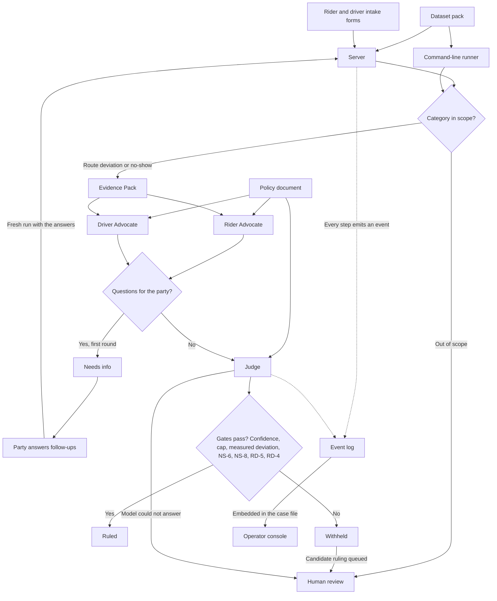

# Ryde — Multi-Agent Autonomous Dispute Resolution

Entry for the **Tencent Cloud "AI CAN DO IT" Hackathon Singapore 2026**, Digital Native track
(the Ryde challenge statement, section 5 of the organisers' document).

**Status: the system runs end to end on the real Tencent Cloud model (ADP), with the
deterministic mock as the default for a fresh checkout.** The scope is ruled: a two-category MVP
(route deviation + no-show charge) with three agents, a deterministic evidence layer, and an
observable case-file view. The challenge statement is in
[`docs/statement-extract.md`](docs/statement-extract.md); the builder's contract is in
[`CODEBUDDY.md`](CODEBUDDY.md).

## Start here

- **Try it online, nothing to install:** three copies are hosted on Tencent EdgeOne. The
  [live AI site](https://ryde-dispute-live.edgeone.dev) runs the real Tencent model, with filings
  limited per visitor and per day ([deploy notes](deploy/edgeone/README.md)). The
  [practice site](https://ryde-dispute-demo.edgeone.dev) runs the deterministic mock. The
  [guided replay](https://ryde-dispute-replay.edgeone.dev/replay/) plays back two recorded real
  cases: a no-show the AI decided alone, and a detour it held for a human decision. Hosted cases
  are not permanent: an idle restart or a redeploy clears them.
- **Try it without a key:** [Run](#run). A new server from the standard launchers uses the deterministic mock; an existing Ryde server is reused as it is.
- **Use approved Tencent access:** [Local live-copy guide](docs/live-copy.md). The live launchers are separate and need a private sidecar.
- **Inspect the design:** [Architecture](docs/architecture.md), [policy](docs/policy.md) and [dataset](docs/dataset.md).
- **Inspect development evidence:** [Conversation history](evidence/conversation-history/README.md) and [screenshots and API-call records](evidence/). CodeBuddy development usage and Tencent demo-call evidence are separate records.

This is a local demonstration with synthetic trip data, not a connection to Ryde's production
accounts or payment systems. It records decisions; it does not transfer money.

## The challenge

Ride-hailing platforms process thousands of dispute tickets daily: fare disputes, route deviations,
property damage, safety incidents, no-show charges. They are subjective, emotionally charged, and
currently resolved by humans reviewing GPS telemetry, chat logs, payment records and company policy
by hand. The result is slow, expensive and inconsistent.

The task is an autonomous multi-agent system that gathers evidence, builds both sides' cases, applies
company policy and issues a fair ruling with a confidence score and a plain-language explanation.

## Architecture

Three core agents, all MVP-required:

| Agent | Role |
|---|---|
| **Rider Advocate** | Builds the rider's case from the Evidence Pack and the policy |
| **Driver Advocate** | Builds the driver's case from the Evidence Pack and the policy |
| **Judge** | Weighs both cases, applies policy, rules, and explains the reasoning with a confidence score |

Inter-agent communication must be **observable** — a judge needs to see how the agents exchange
information and build their cases. That surface is a required deliverable, not a nice-to-have.

The full walkthrough — components, lifecycle, gates, observability — is in
[`docs/architecture.md`](docs/architecture.md). The system on one page:



## Documents

- [`docs/statement-extract.md`](docs/statement-extract.md) — the challenge statement, verbatim
- [`docs/architecture.md`](docs/architecture.md) — architecture diagram and system description
- [`docs/policy.md`](docs/policy.md) — the policy rule set the Judge applies, with per-rule provenance
- [`docs/dataset.md`](docs/dataset.md) — the labelled corpus, its provenance and its limitations
- [`docs/prompts.md`](docs/prompts.md) — how the prompts drive each agent, and what code checks after the model answers
- [`docs/replay.md`](docs/replay.md) — the static replay of a recorded run: how it is exported and what it shows
- [`docs/evidence-plan.md`](docs/evidence-plan.md) — development-process evidence rules
- [`docs/tool-experiences.md`](docs/tool-experiences.md) — running log of how the development tools behaved
- [`docs/build-briefs/`](docs/build-briefs/) — the brief each CodeBuddy build session worked from, kept as a record of the process
- [`CODEBUDDY.md`](CODEBUDDY.md) — builder's entry point and project memory

## Development tooling

Built with Tencent Cloud **CodeBuddy**. The competition mandates proof of product usage, so
development happens in the tool and evidence is captured as it occurs.

## Run

### One-click start

Double-click **`start.command`** (macOS) or **`start.bat`** (Windows). That is the whole setup:
Python 3.9 or newer is the only requirement, and no API key is needed, because the demo runs on
the deterministic mock.

The launcher picks a free port and opens `http://127.0.0.1:8000/start/` — the start page, which
links to the party and operator surfaces. If port 8000 is busy it reuses a Ryde demo already running there;
otherwise it tries 8001 to 8010 and uses the first free one. If you already started the demo
yourself, the launcher reuses that copy as it is. The terminal window stays open while the demo
runs: closing it (or pressing Ctrl+C in it) stops the server, while closing only the browser tab
does not.

A macOS ZIP download may need System Settings, Privacy & Security, **Open Anyway** for the first
double-click. Windows SmartScreen may need **More info**, then **Run anyway**.

### Manual start (fallback)

No dependencies: it runs on a stock Python 3.9+ with the standard library only, using a
deterministic mock in place of the LLM. Start the server and open the pages:

```bash
python3 -m app.server --llm mock
```

- `http://127.0.0.1:8000/start/` is the entry page
- `http://127.0.0.1:8000/` is the operator console (case files, the review queue, human decisions)
- `http://127.0.0.1:8000/party/` is the rider's dispute form, which links to the driver form and the status page
- `http://127.0.0.1:8000/party/driver-filing.html` is the driver's dispute form
- `http://127.0.0.1:8000/party/status.html` looks up a filing by its reference number
- `http://127.0.0.1:8000/party/driver.html` is the read-only sample driver account
- `python3 -m app.server --llm mock --port 8011` serves the same pages on another port

Use the port printed by the launcher if it is not 8000.

### Live start (approved access only)

Double-click **`start-live.command`** (macOS) or **`start-live.bat`** (Windows). This selects
Tencent ADP explicitly, needs internet access and uses credits. Follow the
[live-copy guide](docs/live-copy.md) to supply the private `.env.live` sidecar. No key is
included in the public source.

The live launcher uses port **8030** by default, opens the rider form rather than `/start/`,
and prints the actual party, operator and status URLs. It refuses an occupied port and
does not silently fall back to the mock. If private access is unavailable, use the standard
keyless launchers instead and label the result as mock.

To try the real model without keys, use the hosted [live AI site](https://ryde-dispute-live.edgeone.dev)
listed under [Start here](#start-here).

### Tests and command-line cases

To run the tests and single cases from the command line:

```bash
python3 -m unittest discover -s tests -t .
python3 -m app.cli --pack ryde-synth-v1 --dispute RD-0101
python3 -m app.cli --pack organiser-style-v1 --dispute DISP-002
```

Live evaluation uses credits and requires approved access; it is not needed for the keyless demo.
The evaluation harness replays every labelled case — `python3 -m app.eval --llm tencent --repeat 3` —
and scores the rulings against the labels, answering a round-one stop and running it again.

`--dispute` takes either a dispute id inside the selected pack or a path to a record file
(`python3 -m app.cli --dispute data/packs/ryde-synth-v1/disputes/RD-0101.json`). The pack
defaults to `dataset_pack` in `app/config.json`; `--pack` overrides it for one run.

That prints the agent-to-agent event strip and the ruling, and writes the run's artifacts to
`runs/<run_id>/`: `events.jsonl` (the observable traffic), `payloads/*.json` (the full payload
behind each event) and `case_file.json` (evidence, both claims, resolution).

The rider form is `/party/index.html`; the driver form is `/party/driver-filing.html`.
Both use the shared form script and the same filing API. Save the reference number for
`/party/status.html#reference-input`, which recovers questions and the current outcome.
The rider demo list contains rider filings only. The read-only driver account at
`/party/driver.html` is fixed to D-2009, including T-RD0109; filings on other sample drivers'
trips need reference lookup and do not appear in that account. The forms are local demos,
not signed-in accounts. Entering an amount is a request, not a payment.

The corpus lives in two swappable packs under `data/packs/`: `ryde-synth-v1` (our 17 labelled
cases, our record shape) and `organiser-style-v1` (the same 17 cases as twins in the organisers'
shape, plus the organisers' own `DISP-002` verbatim). `RD-0103` is a deviation too small to matter. `NS-0203` is a driver who marked arrival 885 m
from the pickup point. `RD-0109` is a remedy above the autonomous cap that the system refuses to
issue on its own. `OS-0301` is an out-of-scope filing routed to human review without an LLM call. `docs/dataset.md` maps each case
to what it tests; `<pack>/ground-truth.json` holds the expected outcomes, deliberately kept out
of the records the agents see.

Seven gates stand between a ruling and the parties, and **all seven are enforced in Python, not
asked of the model in a prompt**. The confidence threshold is one of them, and so is ESC-4's SGD
50 autonomous cap. ESC-2 withholds a route-case ruling when the deviation cannot be measured or the
fare charged cannot be established. NS-6 withholds a contested no-show unless the ruling is a
refund of exactly the fee for a low fee and a clean rider record. NS-8 withholds a no-show refund
larger than the recorded fee, any compensation on a no-show case, or any refund whose fee the
record cannot prove. RD-5 withholds a route ruling that refunds less than the overcharge the
records prove. RD-4 withholds a route refund larger than the records prove the rider overpaid (a
fixed fare paid as quoted proves nothing) and any compensation on a route case. Each gate
withholds the ruling for a human; none of them rewrites what the Judge proposed.
Try them:

```bash
python3 -m app.cli --pack ryde-synth-v1 --dispute RD-0109   # withheld: above the cap
python3 -m app.cli --pack ryde-synth-v1 --dispute RD-0108   # withheld: no deviation to measure
```

**Mock by default.** The default provider is a deterministic mock. Its free-text fields (claim
summaries, arguments, the Judge's explanation) are prefixed `MOCK`; actions, amounts, rule IDs and
evidence refs are not. A mock run is a plumbing demonstration, never a real ruling. The real model is
Tencent Cloud ADP, one app per agent: put the three app keys in `.env` (see `.env.example`), then
run `python3 -m app.server --llm tencent` or `python3 -m app.cli --llm tencent --dispute <id>`.

## How this was built

The code in `app/` and `ui/` was written in Tencent Cloud CodeBuddy. A planning agent wrote each
session's brief and its failing tests first; CodeBuddy built until they passed, and the result was
re-checked by running it, not by describing it. The screenshots in `evidence/` record those
sessions as they happened.
