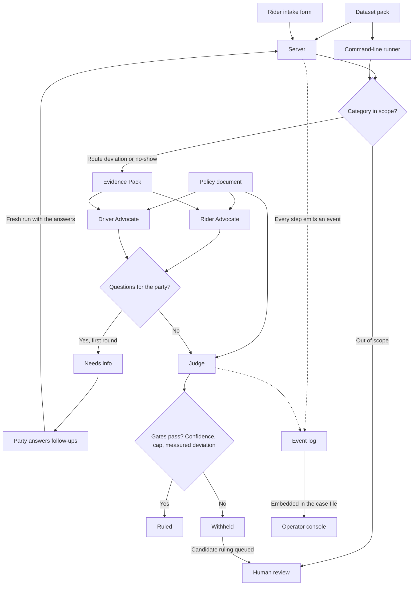

# Architecture

This document explains the system to someone who has read the README and has five minutes.
Every claim here describes the code as it stands; nothing is planned or partial except where
the Limits section says so plainly.

## Overview

Ryde is a multi-agent dispute resolution system for ride-hailing: a party files a dispute
through a web intake form, and the system resolves the two categories it handles — route
deviation and no-show charge — end to end. Three agents do the work: a Rider Advocate and a
Driver Advocate each build their side's case from the evidence, and a Judge weighs both
cases, applies company policy and issues a ruling with a confidence score. Every computed
figure the agents argue from comes from a deterministic Evidence Pack calculated in Python
before any model is called; agents cite pack fields by reference and are forbidden from
doing their own arithmetic, and the only other number they see is the amount the party
asked for. The decisions that must never depend on a model's obedience — the confidence
threshold, the SGD 50 autonomous cap, the requirement that a route ruling rest on a measured
deviation, the one-round follow-up limit, and the routing of out-of-scope categories to
human review — are enforced in Python code, not asked of the model in a prompt. The system
has two surfaces: an operator console that shows the full case file and the agent-to-agent
traffic, and a party page where the filing party submits the form and reads only what they
are allowed to read.

## Diagram

The whole system on one page. A dispute arrives either through the web intake form or the
command-line runner; the two swappable inputs (the policy document and the dataset pack)
enter from the side. Every step of a run lands in the event log, and the operator console
renders the event strip embedded in the case file — opening each event's full payload from
the run files the operator attaches.

## Components

| Component | File(s) | Responsibility |
|---|---|---|
| Pipeline | `app/pipeline.py` | Runs one dispute end to end, moves the case between agents, records every step |
| Dispute record and routing | `app/dispute.py` | Parses the two record shapes, normalises categories, routes out-of-scope filings away |
| Evidence layer | `app/evidence/compute.py` | Computes the Evidence Pack by plain arithmetic; a missing input inside a record becomes a null with a note, never a guess — but a route case with no trip record, or a no-show case with no cancellation record, aborts the run before any pack is built |
| Agent scaffolding | `app/agents/base.py` | Shared prompts, the LLM call, and citation validation against the pack and the policy |
| Rider Advocate | `app/agents/rider_advocate.py` | Argues the rider's side from the pack and the policy |
| Driver Advocate | `app/agents/driver_advocate.py` | Argues the driver's side from the pack and the policy |
| Judge | `app/agents/judge.py` | Weighs both cases, issues one ruling, withholds it behind the gates |
| Event log | `app/events.py` | The append-only record of who said what to whom, with full payloads on disk |
| Output contracts | `app/schemas.py` | The typed shapes agents must produce; builds the party-facing decision message |
| Policy loader | `app/policy.py` | Reads the policy document, extracts rule IDs, fails loudly when it is missing |
| Mock LLM | `app/llm/mock.py` | Deterministic stand-in provider; its free-text fields — claim summaries, arguments, the Judge's explanation — carry a `MOCK` prefix, while actions, rule IDs and evidence refs do not |
| Tencent adapter | `app/llm/tencent.py` | The real provider over HTTP; the endpoint is not pinned yet, so it is never called |
| HTTP server | `app/server.py` | The intake API, the party view allowlist, and static files for both pages |
| Command-line runner | `app/cli.py` | Runs one dispute from the terminal and prints the event strip |
| Runtime configuration | `app/config.json` | Confidence threshold, autonomous cap, default dataset pack, provider settings |
| Operator console | `ui/app.js` | Renders the case file: grievance, evidence, both claims, resolution, event strip |
| Party page | `ui/party/party.js` | The intake form and the outcome view the filing party sees |
| Policy document | `docs/policy.md` | The rule set the agents cite, with per-rule provenance |

## Lifecycle of a dispute

`run_dispute` in `app/pipeline.py` walks one dispute through these steps, in this order,
emitting an event at each:

1. `run.started` — the system records the dispute id, category, LLM provider, confidence
   threshold and the policy rule IDs in force.
2. `dispute.filed` — the raw intake-form submission is logged exactly as it arrived.
3. **Routing.** If the category is outside the two handled ones, the run emits
   `dispute.routed_to_human_review`, then `party.notified` with the neutral support message,
   then `run.completed` — and no agent runs at all.
4. `evidence.pack_built` — the Evidence Pack is computed in Python, before any LLM call,
   and offered to the agents as the source of every computed figure — the only other
   number they see is the amount the party claimed.
5. `case.assigned` — once to each advocate.
6. Each advocate runs and emits `advocate.case_submitted` to the Judge with its case. When
   an advocate wants more from the filing party, it also emits `advocate.follow_up_requested`
   in the first round, carrying the advocate's questions as the model wrote them; the
   party-safety check runs later, and only the questions that pass it reach the party.
7. **Stop and ask.** If there are questions to send and the dispute does not already carry
   the party's answers, the run stops before the Judge: `party.notified` carries the
   questions — the safe ones the advocates wrote, or, when none survive the check, plain
   template questions the pipeline builds for blank intake fields — then `run.completed`
   records the `needs_info` outcome. The party's answers start a fresh run, which is
   guaranteed to reach the Judge.
8. `judge.deliberation_started` — both cases are handed to the Judge together.
9. The Judge rules: `judge.ruling_issued` when every gate passes, or
   `judge.ruling_withheld` when one fails — the candidate ruling is recorded either way.
10. `party.notified` — the message the parties actually receive, as opposed to what was
    decided internally.
11. `run.completed` — the outcome is recorded and the case file is written.

## The four outcomes

| Outcome | When it happens | Did the Judge run? | Party page shows |
|---|---|---|---|
| `ruled` | The Judge issued a ruling and every gate passed | Yes | `decided` |
| `withheld` | A gate stopped the ruling: confidence below threshold, amount above the cap, or an unmeasured deviation on a route case | Yes — the candidate is recorded for a human reviewer, never delivered | `under_review` |
| `human_review` | The category is outside the two the agents handle | No — routed away before any agent | `passed_to_support` |
| `needs_info` | The advocates asked targeted follow-up questions in the first round, or a blank form answer produced a template question | No — the run stops before the Judge | `needs_info` |

## Gates enforced in code

Six gates stand between a filing and a ruling, and each is enforced in Python, not asked of
the model in a prompt:

| Gate | File | Condition as written in code |
|---|---|---|
| Confidence threshold | `app/agents/judge.py` | `ruling.confidence < confidence_threshold` — the threshold is 0.65, read from `app/config.json` |
| ESC-4, the autonomous cap | `app/agents/judge.py` | A money ruling whose `recommended_amount_sgd` exceeds the cap is withheld; the cap is SGD 50 from `app/config.json` |
| ESC-2, unmeasured deviation | `app/agents/judge.py` | On a route-deviation case, `pack.route.deviation_pct is null` withholds the ruling — a route ruling must name the deviation it rests on |
| One-round follow-up limit | `app/pipeline.py` | `if questions and not dispute.follow_up_answers` — a dispute is asked at most once; with answers present the Judge always runs and fresh questions are recorded but not sent |
| Out-of-scope routing | `app/pipeline.py` | `if not dispute.is_agent_handled` — anything outside route deviation and no-show charge goes to human review before any agent runs; an unrecognised category normalises to "other" in `app/dispute.py` |
| Answer once | `app/server.py` | The answers route claims the run with an exclusive create (`O_CREAT \| O_EXCL`) before re-running it — a `needs_info` run can be answered exactly once and cannot produce two rulings |

Why in code? Because a prompt is a request — a model can misread it, and there is no
recourse when it does. Code is a guarantee: the branch either runs or it does not, and the
event log shows which. ESC-4 in particular moves money, so it must not depend on the LLM
having read its instructions carefully.

## Observability

Every run writes three things under `runs/<run_id>/`:

- `events.jsonl` — one JSON line per event, append-only, never rewritten: who sent what to
  whom, when, with a one-line summary.
- `payloads/` — the full payload behind each event, named by sequence number and event
  type, so the strip stays readable and the detail stays one click away.
- `case_file.json` — the assembled record: what was claimed, the evidence pack, both
  advocate cases, the resolution, and the event strip. Self-contained, so one file tells
  the whole story of one run.

A run filed through the server writes one more file: `dispute.json`, the record the pipeline
actually ran on (the command-line runner does not write it). When a `needs_info` run is
answered, its directory also gains `answered.json`, recording which run the answers
produced.

The operator console (`ui/app.js`) renders the case file: the event strip shows one row per
event — sequence, time, sender to recipient, summary — and expanding a row opens the full
payload from the run directory attached in the browser. Payload references are sanitised, so
a console loaded with a hostile file can be pointed at nothing outside the run. The
command-line runner prints the same strip to the terminal.

## What the parties see

`party_view` in `app/server.py` is an allowlist that fails closed. The party page is handed
exactly five keys — run id, dispute id, status, message, questions — and any malformed case
file degrades to the neutral under-review message with no questions. A withheld ruling's
amount and the Judge's confidence are structurally absent from everything the party is
sent, not merely unrendered. `party_message_for_ruling` in `app/schemas.py` composes the
decision message in code from structured fields — the action, the amount, and the plain
titles of the policy rules cited — and the Judge's explanation never crosses this boundary:
it stays in the operator console. Every non-decision status shows a canonical constant
message, whatever a stale or planted case file might say. The two kinds of party-facing text
are protected differently. The decision message is composed in code from structured fields,
so nothing model-written reaches it: it names the action and the amount — a no-action ruling
carries no amount — and at most three rule titles, never the escalation (ESC) rules.
Follow-up questions, by contrast, are written by the advocates' model; the word check
(`is_party_safe`, applied in `_questions_for_party` in `app/pipeline.py` and again in
`party_view`) is what stops an unsafe one, and when no safe question survives, the pipeline
falls back to plain template questions built from the form's own labels. The word list is
incomplete, so for questions it is a real but imperfect filter. A run that asked for more
information is answered through `POST /api/disputes/<run_id>/answers`, and the answers start
a fresh run on the same dispute.

## Policy and dataset packs

`docs/policy.md` is data, not code: rules with IDs (GEN, EV, RD, NS, ESC families),
preconditions written against pack fields in plain language, and per-rule provenance
stating whether a rule comes from Ryde's own published policy, a comparable operator, or
the project team. The pipeline reads it at the path in `app/config.json`; a different
policy document drops in with no code change. Nothing in the code evaluates the
preconditions — the Judge reads the rules and applies them in its reasoning. Citing a rule
that does not exist is recorded rather than blocked: an unknown ID is logged under the
ruling's `validation.unknown_rule_ids` with a note and the ruling still issues, but only
titles of rules the policy actually defines can reach the party message.

Two dataset packs live under `data/packs/`: `organiser-style-v1` — the default in
`app/config.json` — which holds the corpus in the organisers' record shape, including their
own DISP-002 verbatim; and `ryde-synth-v1`, the same 17 cases in this project's own record
shape. Swapping corpora is a directory copy, never a code change. Each pack carries a
`ground-truth.json` of expected outcomes, kept out of what the agents see: the agents get
the dispute record, the evidence pack and the policy — never the answer — so replayed-run
consistency can be measured honestly.

## LLM provider

Agent logic never talks to a vendor SDK. Every agent builds a request and calls one seam:
the `LLMClient` interface in `app/llm/`, a single `complete` method whose response carries
the text plus provenance (provider, model, usage, finish reason). Two adapters implement
it. The mock provider, `app/llm/mock.py`, returns deterministic contract-shaped responses,
so the full pipeline runs with no API key and the same dispute always produces the same
decisions and the same computed figures (the run id and the event timestamps differ from
run to run). Its free-text fields — claim summaries, arguments, the Judge's explanation —
carry a `MOCK` prefix, so a mock run can never be mistaken for a real ruling; actions, rule
IDs and evidence refs are not prefixed, and the party decision message, composed in code,
carries none. The Tencent adapter, `app/llm/tencent.py`, implements the same
interface over HTTP — and is honest about its status: the concrete service, endpoint, auth
scheme and payload shape are not pinned yet, the configuration still carries placeholder
values, and the adapter fails loudly rather than silently falling back to the mock. To be
plain: the Tencent endpoint has not been called. Every run to date is a mock run, a
plumbing demonstration rather than a model judgement.

## Limits

What the system does not do yet, stated plainly:

- **No real LLM calls.** The mock provider answers every agent. Nothing here has reasoned
  about a dispute; the machinery around the reasoning is what is built and tested.
- **Two categories only.** Route deviation and no-show charge. Property damage and safety
  incidents route to human review by design.
- **The driver-side form is not built.** The party page files as the rider only; the
  pipeline itself accepts driver-filed disputes, but no web form offers it yet.
- **The word check is incomplete by design.** For follow-up questions it is a real but
  imperfect filter: a keyword list over a banned vocabulary, not a semantic guarantee. It
  is the gate those questions pass through, and when none survive it, the pipeline falls
  back to template questions built from the form's own labels.
- **Policy preconditions are not evaluated by code.** The rules are written against pack
  fields in plain language; nothing checks them mechanically, and the Judge applies them by
  reading them.
