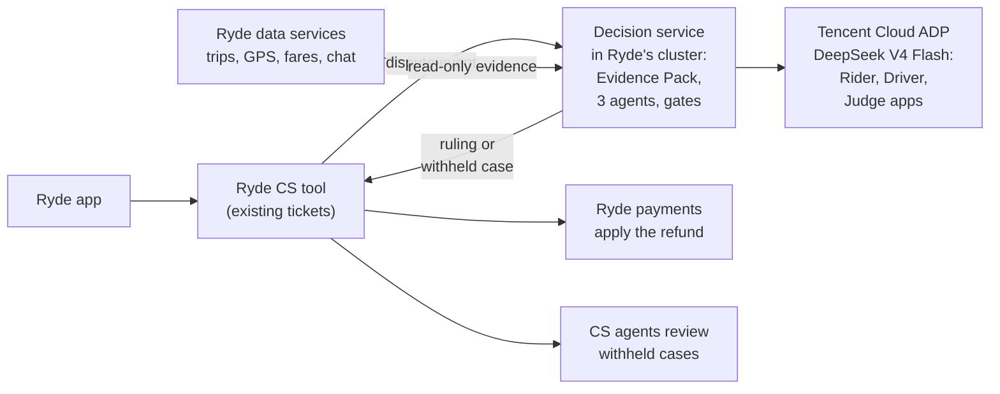

# Deployment slides: content

Source text for the deployment part of [ryde-dispute-pitch.pptx](ryde-dispute-pitch.pptx). Slides 5 to 7 are in the
video; slides 8 to 13 are reference slides kept for Q&A (not in the video timeline). Each has the slide text,
then speaker notes. The diagram on slide 5 is Mermaid (`deploy-architecture.mmd`).

**Proposal:** embed the decision service in Ryde's existing system. The one-off cost is Ryde's own staff time
and the running cost is API tokens (DeepSeek V4 Flash on Tencent Cloud ADP). A hosted service is offered as the
alternative (slide 13).

Verification status: the DeepSeek V4 Flash token rates are verified from Tencent Cloud's ADP pricing page.
Tokens per case (about 50k in, 3.5k out), staff cost, volume and the dispute rate are assumptions. DeepSeek V4
Flash has not been scored on this task: run the evaluation harness before go-live.

---

## Slide 5 (in the video): Embed it in Ryde's existing system

**Headline:** Ryde keeps the money and the customer: the service only recommends.

The image is embedded in the deck. `deploy-architecture.mmd` adds the theme; re-render with
`mmdc -i deploy-architecture.mmd -o deploy-architecture.png -s 3 -b white`.

**On the slide:** the diagram; "Ryde keeps the money and the customer: the service only recommends. Rollout:
shadow, assist, limited autonomy, expand."; footer "Runs on Ryde's own infrastructure: only the model calls
leave, to Tencent Cloud ADP."

**Speaker notes:** A rider's report becomes a ticket in the existing CS tool; the ticket publishes a dispute
event; our decision service, running in Ryde's cluster, reads evidence from Ryde's services, calls the three
ADP apps, and returns a ruling or a withheld case to the same tool. Ryde's payments apply any refund and its
CS agents review withheld cases where they already work.

---

## Slide 6 (in the video): Cost

**Headline:** About S$120k of staff time, then S$14 a month.

- **S$120k one-off, staff time:** 2 engineers × 4 months, plus PM, QA and security review. Not a new cash outlay.
- **S$14 a month to run:** API tokens only, about S$0.01 a case on DeepSeek V4 Flash. No new infrastructure or support staff.
- **9 months to limited autonomy:** 4 build, 2 shadow, 3 assist.
- Even on DeepSeek V4 Pro, running cost is about S$170 a month.

## Slide 7 (in the video): ROI

**Headline:** Doing nothing costs about S$400k over three years.

At the base case (1% of trips disputed, 40% in scope, S$7.50 each, 10% yearly growth, AI decides 60%):
do nothing S$397k; with the system S$244k (staff time + tokens + remaining manual work); S$153k saved, a 127%
return on the staff time; payback month 21. Payback by dispute rate: 0.5% month 33, 1.5% month 17, 2% month 14.
The saving is cash only if Ryde avoids hiring, overtime or outsourcing as volume grows.

---

## Slide 8 (reference): Cost breakdown

One-off staff time: 2 engineers × 4 months at S$12,000 a month = S$96k, plus PM, QA and security review S$24k =
S$120k (assumed). Model cost per month at 1,333 cases: DeepSeek V4 Flash US$11 (S$14), V4 Pro US$132 (S$171),
V3.1 US$342 (S$443), GPT-5.5 US$473 (S$612). Excludes any ADP platform plan (Starter US$50 a month).

## Slide 9 (reference): Dispute-rate sensitivity and benchmarks

3-year net saving and payback month by dispute rate (0.25% to 2% of trips) and volume growth (0%, 10%, 17%).
Break-even about 0.50% of trips at flat volume, 0.44% at 10% growth. References: Grab publishes no rate; Uber's
total support contacts are about 1.3 per 100 trips (all topics); Ryde's verified revenue grew 17%, mobility 8%.

## Slide 10 (reference): How it plugs into Ryde

| Ryde does | The service does |
|---|---|
| Publishes a dispute event from its CS tool, with trip id, category, claim | Reads evidence read-only from Ryde's own services, builds the Evidence Pack, runs the agents |
| Shows status in its own ticket screen | Returns `ruling.issued`, `ruling.withheld`, `needs_info` or `human_review` |
| Applies the refund through its payments, idempotently | Never moves money, never talks to the rider's app |
| Shows withheld cases to its CS agents in the tool they already use | Records every reviewer decision and who made it |

Runs in Ryde's cluster: only the model calls leave, to Tencent Cloud ADP. The party view stays a five-key
allowlist (no confidence, no model text). The same contract works if Ryde prefers a hosted service.
Contract: `tools/deployment/openapi.json`.

## Slide 11 (reference): Controls and honest limits

**Built today:** SGD 50 cap and 0.65 confidence floor, enforced in code; every reviewer decision logged with who made it.

**Before go-live:** add a kill switch that pauses every ruling and remove personal data before any AI call.
The proposed production deployment keeps data in Ryde's environment, with only model calls leaving.

**Honest limits:** the policy is synthesised and must be adopted by Ryde ops, legal and finance before autonomy;
17 labelled cases show consistency, not real-world accuracy; no platform publishes its dispute rate, so ours is
an assumption until shadow mode; DeepSeek V4 Flash is unproven here (score it first; V4 Pro is the fallback);
staff time is not cash, so savings are cash only if Ryde avoids hiring.

## Slide 12 (reference): System architecture

The diagram in `docs/architecture.md`, laid out to fit a slide: the same nodes and edges, with the layout set by
hand because Mermaid cannot be shaped to a slide. The image is embedded in the deck; the generator
`render-system-architecture.js` re-creates it (PNG and SVG). If `docs/architecture.md` changes its diagram,
update the generator's node and edge lists to match.

## Slide 13 (reference): Deployment options compared

| | A. Embedded in Ryde (proposed) | B. Hosted service | C. No AI |
|---|---|---|---|
| How | Our service runs in Ryde's cluster, inside its CS tool | We host it on Tencent Cloud: signed events in, decisions out | Human agents, as today |
| One-off | S$120k of Ryde staff time | S$90k, paid to build it | none |
| Running / month | about S$14 (tokens only) | about S$1.7k (cloud, tokens, 0.1 engineer) | none, but cost grows with volume |
| 3-year spend | S$244k | S$262k | S$397k |
| Payback | month 21 | month 20 | n/a |
| Trade-off | Needs Ryde engineers; slower start | Fast and isolated; new infrastructure to run | 24-72 h resolution, inconsistent rulings |

Same assumptions as slide 7 and DeepSeek V4 Flash in both options. Both use the same integration contract, so the
choice can be changed later.
