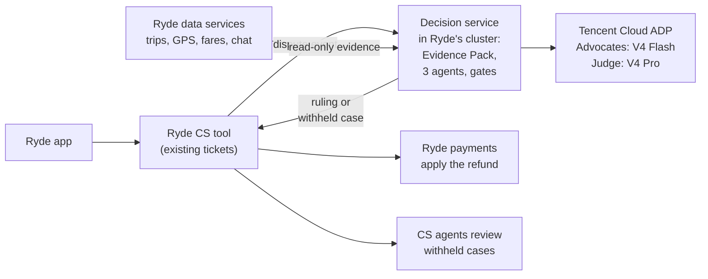

# Deployment slides: content

Source text for [ryde-dispute-pitch.pptx](ryde-dispute-pitch.pptx). Slides 5 to 7 are the business section of the video; slides 8 to 13 are reference slides for Q&A. The current filming order is agreed separately with the team. The diagram on slide 5 is Mermaid (`deploy-architecture.mmd`).

**Proposal:** embed the decision service in Ryde's existing system. The one-off cost is Ryde's own staff time. The serving roles are **Advocates: V4 Flash; Judge: V4 Pro**, through Tencent Cloud ADP, as checked on 14 October 2026. A hosted service is the alternative on slide 13. This is a deployment proposal, not a production integration.

**Costing correction, 16 October 2026:** the old S$14/month figure assumed all three roles used unversioned Flash pricing. It is not the current mixed-model bill. We have not measured per-role token usage, retries or actual billed SKUs. Instead, the slides use a **S$175/month token budget**, at the assumed base volume and aggregate token allowance below. This is an illustrative planning provision, **not measured** spending, a platform spending cap, or a guarantee.

The reference rate rows checked on [Tencent's pricing page](https://www.tencentcloud.com/document/product/1300/78937) on 16 October are Flash 0731 GA peak at US$0.44 input / US$1.32 output, unversioned V4 Pro at US$1.74 / US$3.48, and Pro 0813 GA peak at US$1.32 / US$3.96, all per million uncached tokens. The pricing row actually billed by the apps needs console/invoice confirmation. At an assumed 50k input + 3.5k output tokens per whole case, 1,333.33 cases/month and US$1 = S$1.30, an all-Flash-GA-peak reference is S$46/month and an all-unversioned-Pro reference is S$172/month. S$175 also covers the highest input and output reference rates combined at that allowance. No arbitrary one-third token split is assumed.

Extra tokens/calls, different rates and platform fees can exceed the provision. Caching savings are not assumed. Any ADP platform subscription is excluded. Staff cost, workload, automation share, growth and tokens per case are assumptions, not measured results. The business model is reproducible with `python3 tools/deployment/cost_model.py`.

---

## Slide 5 (in the video): Embed it in Ryde's existing system

**Headline:** Ryde keeps the money and the customer: the service only recommends.

The image is embedded in the deck; `deploy-architecture.mmd` adds the theme. This correction preserves the existing PNG layout and changes only the ADP node's text. It is not a fresh Mermaid render. With Mermaid CLI installed, regenerate using `mmdc -i deploy-architecture.mmd -o deploy-architecture.png -s 3 -b white`; the resulting layout may differ and needs a visual check. That regeneration command was not exercised in this round.

**On the slide:** the diagram; "Ryde keeps the money and the customer: the service only recommends. Rollout: shadow, assist, limited autonomy, expand." Footer: "Runs on Ryde's own infrastructure: only the model calls leave, to Tencent Cloud ADP."

**Speaker notes:** A report becomes a ticket in Ryde's existing CS tool. The proposed service reads trip evidence, runs two Flash advocates and the Pro Judge, and returns a ruling or withheld case. Ryde's payments would apply any refund; the prototype records decisions and does not transfer money.

---

## Slide 6 (in the video): Cost

**Headline:** About S$120k of staff time; budget S$175 a month for tokens.

- **S$120k one-off, staff time:** 2 engineers x 4 months, plus PM, QA and security review. An opportunity cost, not a new cash outlay.
- **S$175/month token budget:** Flash advocates + Pro Judge. Not measured billing. Assumed aggregate tokens and volume, with no new infrastructure or support staff in the embedded option.
- **9 months to limited autonomy:** 4 build, 2 shadow, 3 assist.

Use the actual billed SKU and measured token use before committing to a production budget. ADP plan fees are excluded.

## Slide 7 (in the video): ROI

**Headline:** Doing nothing costs about S$400k over three years.

At the base assumptions, 1% of trips disputed, 40% in scope, S$7.50 manual handling each, 10% yearly growth, 60% autonomous after rollout: do nothing **S$397k**; with the embedded system **S$250k**; **S$147k saved**, **123% return** on the S$120k staff-time investment; payback **month 21**. The revised chart includes the S$175/month base token provision, scaled with case volume.

Payback by dispute rate at 10% growth: 0.5% month 34, 1% month 21, 1.5% month 17, 2% month 15. These are assumptions, not measured Ryde savings. Staff-time savings become cash savings only when hiring, overtime or outsourcing is avoided.

---

## Slide 8 (reference): Cost breakdown

One-off staff time: 2 engineers x 4 months at S$12,000/month = S$96k, plus PM, QA and security review S$24k = S$120k, assumed.

Token scenarios at the assumed 1,333.33 cases/month and 50k input + 3.5k output tokens/case:

| Reference | US$/month | S$/month |
|---|---:|---:|
| Flash 0731 GA peak, all tokens | 35.49 | 46.14 |
| Unversioned V4 Pro, all tokens | 132.24 | 171.91 |
| Mixed-model planning provision | 134.62 equivalent | 175.00 |

The references are alternative public price rows, not proof of the apps' actual billed SKU. Current roles are Flash advocates + Pro Judge. The provision makes no assumed per-role token split; actual usage is not measured. FX S$1.30/US$1 is an assumption. Excludes ADP platform plans and caching benefits. Formula and rates: `cost_model.py`.

## Slide 9 (reference): Dispute-rate sensitivity and benchmarks

Each cell is the 3-year net saving in S$k and payback month. Same token provision, rollout and staff assumptions as slides 6 to 8. "None" means no payback within 36 months.

| Disputes, % of trips | Growth 0% | Growth 10% | Growth 17% |
|---|---|---|---|
| 0.25% | -61k, none | -53k, none | -48k, none |
| 0.5% | -2k, none | +14k, month 34 | +25k, month 32 |
| 1% | +117k, month 22 | +147k, month 21 | +170k, month 21 |
| 1.5% | +235k, month 17 | +281k, month 17 | +314k, month 17 |
| 2% | +354k, month 15 | +414k, month 15 | +459k, month 14 |

Break-even over 3 years is about 0.51% of trips at flat volume or 0.45% at 10% annual growth. The previous all-Flash calculation is superseded.

Existing reference context, not a Ryde dispute-rate measurement: Grab publishes no rate; Uber's total support contacts are about 1.3 per 100 trips across all topics, derived from its February 2024 engineering blog and FY2025 10-K, figures two years apart. Ryde's reported revenue grew 17%, mobility 8%. Shadow mode must replace the workload assumptions with actual data.

## Slide 10 (reference): How it plugs into Ryde

| Ryde does | The service does |
|---|---|
| Publishes a dispute event from its CS tool, with trip id, category, claim | Reads evidence read-only from Ryde's own services, builds the Evidence Pack, runs the agents |
| Shows status in its own ticket screen | Returns `ruling.issued`, `ruling.withheld`, `needs_info` or `human_review` |
| Applies the refund through its payments, idempotently | Never moves money, never talks to the rider's app |
| Shows withheld cases to its CS agents in the tool they already use | Records every reviewer decision and who made it |

Runs in Ryde's cluster: only the model calls leave, to Tencent Cloud ADP. The party view stays a five-key allowlist, no confidence or model text. The same proposed contract works if Ryde prefers a hosted service. Contract: `tools/deployment/openapi.json`, a proposal rather than a deployed integration.

## Slide 11 (reference): Controls and honest limits

**Built today:** SGD 50 cap and 0.65 confidence floor, enforced in code; every reviewer decision logged with who made it.

**Before go-live:** add a kill switch that pauses every ruling and remove personal data before any AI call.
The proposed production deployment keeps data in Ryde's environment, with only model calls leaving.

**Honest limits:** the policy is synthesised and must be adopted by Ryde ops, legal and finance before autonomy. In the saved **3 October 2026** evaluation, **17 of 18** outcomes matched the team's labels, and 14 of 18 were decided without a human. This was **before the model switch** to Flash advocates + Pro Judge, not a new result on the current build. It is demonstration-corpus evidence, not real-world accuracy or repeated-run consistency. Measure the current mix before go-live. Workload and cost remain assumptions; staff time is not cash unless Ryde avoids hiring, overtime or outsourcing.

## Slide 12 (reference): System architecture

The diagram in `docs/architecture.md`, laid out to fit a slide: the same nodes and edges, with the layout set by hand. It is embedded in the deck; `render-system-architecture.js` re-creates it. The runtime architecture is unchanged by this presentation correction.

## Slide 13 (reference): Deployment options compared

| | A. Embedded in Ryde, proposed | B. Hosted service | C. No AI |
|---|---|---|---|
| How | Our service in Ryde's CS system | We host it; signed events in, decisions out | Human agents, as today |
| One-off | S$120k of Ryde staff time | S$90k to build | None |
| Running/month | S$175 token budget | About S$1.9k, cloud + tokens + 0.1 engineer | None, but cost grows with volume |
| 3-year spend | S$250k | S$268k | S$397k |
| Payback | Month 21 | Month 20 | n/a |
| Trade-off | Needs Ryde engineers | Faster start, new infrastructure | 24-72 h resolution, inconsistent rulings |

Both AI options budget for Flash advocates + Pro Judge, not all-Flash billing. Same workload assumptions as slide 7. Hosted running provision is S$500 cloud + S$1,200 operator time + S$175 tokens = S$1,875/month at base volume, rounded to S$1.9k. Hosted rollout is 3 build, 2 shadow, 3 assist, limited autonomy from month 9. The embedded option is 4 build, 2 shadow, 3 assist, limited autonomy from month 10. These are planning scenarios, not production results.
