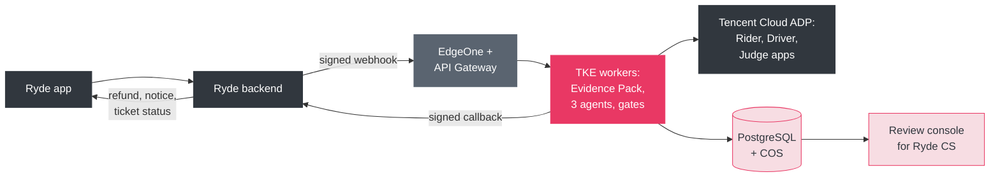

# Deployment slides: content

Source text for the deployment part of [ryde-dispute-pitch.pptx](ryde-dispute-pitch.pptx). Slide 5 is in the
video; slides 10, 11 and 12 are reference slides kept for Q&A (not in the video timeline). Each has the slide
text, then speaker notes. The diagram is Mermaid, for redrawing in another tool.

Verification status of product claims: ADP model and plan prices, EdgeOne plan prices and TKE cluster fees are
verified from Tencent Cloud's published pages; the other cloud prices are estimates (see the cost breakdown, slide 8),
and Singapore-region availability should be confirmed before committing.

---

## Slide 5 (in the video): Deploy on Tencent Cloud, plug in with one webhook

**Headline:** The decision core stays. The shell becomes cloud-native.

This is the diagram on slide 5: source `deploy-architecture.mmd` (adds the theme). The image is embedded in the deck and
is not kept as a separate file; re-render it with `mmdc -i deploy-architecture.mmd -o deploy-architecture.png -s 3 -b white`.

**On the slide:**
- Ryde app → Ryde backend → EdgeOne + API Gateway → TKE workers → Tencent Cloud ADP
- Signed webhook in (`dispute.created`), signed callback out; Ryde's payments execute any refund
- PostgreSQL (also the queue and shared rate limit at this volume), COS, SSM/KMS
- Rollout: 1 Shadow, 2 Assist, 3 Limited autonomy, 4 Expand (3 months build, 2 shadow, 3 assist)

**Speaker notes:** The advocates, Judge, Evidence Pack and gates do not change; only storage, transport and
identity do. We already call Tencent Cloud ADP with one app per agent, so the model layer is the part that is
already production-shaped.

---

## Slide 10 (reference): How it plugs into Ryde

**Headline:** One signed webhook in, one signed callback out.

| Ryde does | The service does |
|---|---|
| Sends `dispute.created` with trip id, category, claim | Reads evidence read-only, builds the Evidence Pack, runs the agents |
| Shows status in its own ticket screen | Returns `ruling.issued`, `ruling.withheld`, `needs_info` or `human_review` |
| Applies the refund (wallet or original method), idempotently | Never moves money, never talks to the rider's app |
| Opens the case file inside its CS tool, behind SSO | Records every reviewer decision and who made it |

**Details worth one line each:**
- Trip and category are pre-filled from the rider's session, so no one picks a trip by hand
- The party view stays a five-key allowlist: no confidence, no model text
- Callbacks are at-least-once and signed; every write carries an idempotency key
- Contract: `tools/deployment/openapi.json`

**Speaker notes:** The rider never leaves the Ryde app. They see "Report a problem with this trip", and the
outcome shows up as a ticket status. The same fail-closed party view we show today is what the callback carries.

---

## Slide 11 (reference): Controls and honest limits

**Headline:** Earn autonomy with data, not claims.

**Controls that ship from day one:**
- SGD 50 cap and 0.65 confidence floor, enforced in code
- Kill switch that withholds every ruling
- PII redaction before any model call
- Singapore data residency, retention and a delete job
- Every reviewer decision logged with who made it

**Honest limits (say them out loud):**
- The policy is synthesised: Ryde ops, legal and finance must adopt it before autonomy
- 17 labelled cases show internal consistency, not real-world accuracy
- No platform publishes its dispute rate; ours is an assumption until shadow mode measures it
- Production needs a paid ADP plan; capacity is roughly model calls per minute divided by 4
- Some cloud prices are estimates until confirmed in the pricing calculator (slide 8)

**Speaker notes:** Shadow mode is the first deliverable: it produces the first real accuracy number and the
human-override data without risking a customer.

---

## Slide 12 (reference): System architecture

**Headline:** The whole system on one page.

The diagram is the one in `docs/architecture.md`, laid out to fit a slide: the same nodes and edges, with the
layout set by hand because Mermaid cannot be shaped to a slide. The image is embedded in the deck; the generator
`render-system-architecture.js` re-creates it (PNG and SVG). If `docs/architecture.md` changes its
diagram, update the generator's node and edge lists to match.

**Speaker notes:** Walk it left to right: a dispute enters through the intake forms or the command-line runner;
a category check sends anything outside route deviation and no-show to human review before any agent runs; the
Evidence Pack is computed in Python; the two advocates argue with the policy; if they need more, the party is
asked once and the run restarts with the answers; the Judge rules; the gates decide whether the ruling is
delivered or withheld for a human; every step lands in the event log the operator console shows.
