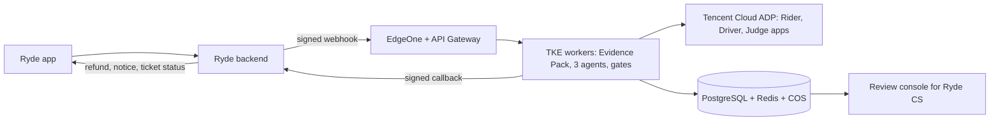

# Deployment slides: content draft

Three slides for the Feasibility part of the pitch. Each has the slide text, then speaker
notes. The diagram source is Mermaid so it can be rendered or redrawn in the deck tool.
Product names and Singapore-region availability are unverified: confirm before presenting.

---

## Slide 1: From prototype to Ryde production, on Tencent Cloud

**Headline:** The decision core stays. The shell becomes cloud-native.

**On the slide (max 5 lines):**
- Queue-fed workers on **TKE**, three **ADP** apps for the model layer
- **PostgreSQL / Redis / COS** replace local files; **SSM + KMS** hold the keys
- **EdgeOne + API Gateway** at the edge; private link to Ryde's data
- Ryde keeps the money: the service recommends, Ryde's payments execute

**Speaker notes:** The advocates, Judge, Evidence Pack and gates do not change; only storage,
transport and identity do. We already call Tencent Cloud ADP with one app per agent, so
the model layer is the part that is already production-shaped.

---

## Slide 2: How it plugs into Ryde

**Headline:** One signed webhook in, one signed callback out.

| Ryde does | The service does |
|---|---|
| Sends `dispute.created` with trip id, category, claim | Reads evidence read-only, builds the Evidence Pack, runs the agents |
| Shows status in its own ticket screen | Returns `ruling.issued`, `ruling.withheld`, `needs_info` or `human_review` |
| Applies the refund (wallet or original method), idempotently | Never moves money, never talks to the rider's app |
| Opens the case file inside its CS tool, behind SSO | Records every reviewer decision and who made it |

**Details worth one line each:**
- Trip and category are pre-filled from the rider's session, so no one picks a trip by hand
- Party view stays the five-key allowlist: no confidence, no model text
- Contract: `tools/deployment/openapi.json`

**Speaker notes:** The rider never leaves the Ryde app. They see "Report a problem with this
trip", and the outcome shows up as a ticket status. The same fail-closed party view we show
today is what the callback carries.

---

## Slide 3: Rollout, controls and honest limits

**Headline:** Earn autonomy with data, not claims.

| Phase | Behaviour | Moves on when |
|---|---|---|
| 1. Shadow | Rules on real tickets; customers see nothing | Agreement with human decisions measured per category |
| 2. Assist | A CS agent accepts or changes each proposal | Override rate and reasons are known |
| 3. Limited autonomy | Auto-decide narrow slices, e.g. contested no-show refunds under SGD 10 | Error rate under an agreed bound |
| 4. Expand | More categories and higher caps | Each step gated on measured data |

**Controls that ship from day one:** SGD 50 cap and 0.65 confidence floor in code · kill switch
that withholds every ruling · PII redaction before any model call · Singapore data residency ·
retention and delete job.

**Honest limits (say them out loud):**
- Our policy is synthesised; Ryde ops, legal and finance must adopt it before autonomy
- 17 labelled cases show internal consistency, not real-world accuracy
- Production needs a paid ADP quota; capacity is roughly calls per minute divided by 3

**Speaker notes:** Shadow mode is the first deliverable: it produces the first real accuracy
number and the human-override data without risking a customer.
